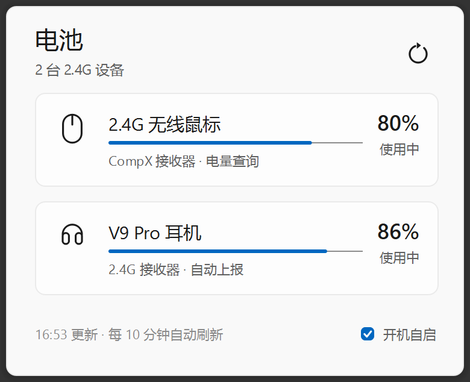

# 2.4G 设备电量助手

一个常驻 Windows 系统托盘的小工具：读取 2.4G 接收器下鼠标、耳机的电量，点托盘图标弹出无边框面板查看，低电量时主动提醒。



## 特性

- **即插即用**：自动识别接收器下的设备，无需手动选择端口或配对
- **托盘常驻**：左键单击弹出/收起面板，右键打开菜单，中键立即刷新
- **轻量面板**：380px 宽的无边框圆角弹窗，贴在托盘图标上方；失焦自动收起，Esc 关闭
- **不卡界面**：HID 查询在后台线程池执行（单次耗时 0.4~1.5 秒），期间刷新按钮转圈提示
- **低电量提醒**：低于 20% 弹一次系统通知，同一设备充满前不重复打扰；离线或读数未知不报
- **定时刷新**：默认每 10 分钟一次，可在 `app/theme.py` 调整
- **开机自启**：面板右下角勾选即可，注册表与启动文件夹双写，被清理后下次启动自动补回
- **单实例**：重复启动只会把已在运行的面板叫出来，不会开第二个进程

## 支持的设备

| 设备 | VID | 读取方式 |
| --- | --- | --- |
| A7 Ultra 鼠标 | `0x5253` | HID Feature Report：`SetFeature(0x11)` → 延时 0.4s → `GetFeature(0x11)`，响应逐字节取反后解析电量、充电状态、连接模式 |
| V9 Pro 耳机 | `0x291D` | Usage Page `0xFF90` 集合，Output 报告 `rid=85` 写入查询帧 → 读回报文，取 `[电量, 状态]`（充电/放电/充满/睡眠） |

两种协议都只用 `ctypes` 直接调 `setupapi` / `hid` / `kernel32`，没有任何 HID 第三方库依赖。

要支持新设备（例如 2.4G 键盘），在 `app/devices.py` 的 `SPECS` 里加一条记录（标题、图标、副标题、查询函数），再在 `app/hid.py` 补一个查询函数即可；界面会自动多出一张卡片，并按数量自适应面板高度。

## 环境要求

- Windows 10 / 11（依赖 `setupapi`、`hid.dll` 和系统托盘行为，不支持其他平台）
- Python 3.10+（开发验证于 3.11）
- PySide6 ≥ 6.10

## 安装与运行

```bash
git clone <仓库地址>
cd mchose-battery
pip install -r requirements.txt

python run.py           # 启动并弹出面板
python run.py --tray    # 只驻留托盘，不弹面板（适合开机自启）
```

首次运行会自动写配置到 `%LOCALAPPDATA%\McHoseBattery\settings.json`，启动日志在同目录的 `startup.log`（每次启动追加一行，超过 200 KB 自动清空）。

## 使用说明

| 操作 | 效果 |
| --- | --- |
| 左键单击托盘图标 | 打开 / 收起面板 |
| 右键单击托盘图标 | 打开菜单：打开面板、立即刷新、开机自启动、退出 |
| 中键单击托盘图标 | 立即刷新 |
| 面板右上角刷新按钮 | 立即刷新（查询中显示旋转动画） |
| 面板右下角「开机自启」 | 切换开机自启动，与托盘菜单里的勾选状态双向同步 |
| 鼠标悬停托盘图标 | 提示当前各设备电量摘要 |
| 面板内按 Esc / 点击别处 | 收起面板 |

面板为空时显示「接入 2.4G 接收器后会自动显示」；某台设备未连接时该卡片自动隐藏，只展示在线设备。

## 配置项

集中在 `app/theme.py`，改完重启生效：

| 常量 | 默认值 | 说明 |
| --- | --- | --- |
| `REFRESH_INTERVAL` | `600` | 自动刷新间隔（秒）。**不要低于 60 秒**，鼠标固件对高频查询不稳定 |
| `LOW_THRESHOLD` | `20` | 低电量阈值（百分比，严格小于才触发，即 20% 不报、19% 报） |
| `PANEL_W` | `380` | 面板宽度（逻辑像素） |
| `ACCENT` / `LOW` | `#0067C0` / `#C42B1C` | 主色与低电量色 |

界面尺寸按 2 倍设计图折算成逻辑像素，Qt 会跟随系统 DPI 缩放。

## 项目结构

```
mchose-battery/
├─ run.py                入口：开发时 python run.py
├─ app/
│  ├─ main.py            应用组装、单实例、信号连线、低电量判定
│  ├─ hid.py             HID 协议层（ctypes 直连 setupapi / hid / kernel32）
│  ├─ devices.py         设备清单与读数模型（加新设备改这里）
│  ├─ service.py         后台轮询（QThreadPool + QTimer）
│  ├─ flyout.py          主面板：无边框圆角弹窗、定位、失焦收起
│  ├─ tray.py            托盘图标与圆角菜单
│  ├─ widgets.py         设备卡片 / 电量条 / 刷新按钮 / 自启勾选
│  ├─ icons.py           纯 QPainter 线条图标（鼠标 / 耳机 / 键盘 / 刷新）
│  ├─ theme.py           颜色、字号、尺寸、阈值与刷新间隔
│  ├─ autostart.py       开机自启动（注册表 + 启动文件夹 + 路径自愈）
│  └─ config.py          设置存储与启动日志
├─ third_party/siui/     内置 SiliconUI（GPLv3，见其 LICENSE）
├─ tools/                离线预览、设计稿对照、冒烟测试
├─ assets/               应用图标（app.ico / logo_source.png）
├─ docs/                 README 用截图
├─ build.spec            PyInstaller 打包配置
├─ version_info.txt      exe 版本资源（决定通知横幅里显示的应用名）
└─ requirements.txt
```

## 开发工具

三个脚本都在 `tools/` 下，用文件相对路径定位项目根目录，可以直接在任意目录调用。

```bash
# 用假数据渲染面板并截图（不碰真实硬件，便于调界面）
python tools/preview.py preview.png

# 把设计稿与渲染结果上下拼接，逐项核对间距与字号
python tools/compare.py 设计稿.png [渲染图.png]

# 冒烟测试：真实启动应用，截图并打印托盘、面板、菜单状态
python tools/smoke.py
```

`tools/smoke.py` 会在项目根目录留下 `smoke_flyout.png` / `smoke_menu.png`（已加入 `.gitignore`），并真实读取硬件，需要插好接收器。

## 打包

```bash
pip install pyinstaller
pyinstaller build.spec --noconfirm
# 产物：dist/2.4G设备电量助手/2.4G设备电量助手.exe（整个目录一起分发）
```

打包版带了 `version_info.txt` 里的版本资源，系统通知横幅会显示「2.4G 设备电量助手」而不是文件名。`assets/app.ico` 与 SiliconUI 的图标包会在打包时一并带上。

## 注意事项

- **只支持 Windows**：协议层直接调 Win32 API，界面依赖系统托盘行为。
- **刷新频率**：鼠标固件对连续查询不稳定，间隔过低会读到回显帧导致解析失败，保持 ≥ 60 秒。
- **开机自启自愈仅在打包版生效**：`python run.py` 调试时不会改写注册表，避免把自启动指向 `python.exe`；手动点击开关仍会读写注册表。
- **配置与日志**：都写在 `%LOCALAPPDATA%\McHoseBattery\`，卸载时删除该目录即可清干净。
- **SiliconUI 是 GPLv3**：本项目因而整体以 GPL-3.0 开源。若要闭源分发，需要替换掉自绘控件或单独取得授权。

## 许可证

本项目以 [GPL-3.0](LICENSE) 发布，因为使用了 GPLv3 的 [SiliconUI](https://github.com/ChinaIceF/SiliconUI)：

- `app/`、`run.py`、`tools/` —— 本项目代码，GPL-3.0
- `third_party/siui/` —— SiliconUI 原样内置，版权归原作者，见 `third_party/siui/LICENSE`
  - 其中 `components/menu_.py` 有本地改动（勾选标记的留白按整个菜单统一计算、菜单项文字左对齐），已在文件注释中标注
- `assets/` 图标资源随项目同协议使用

MCHOSE 及相关商标归其各自所有者。本项目为个人自用工具，与 MCHOSE 官方无关。
